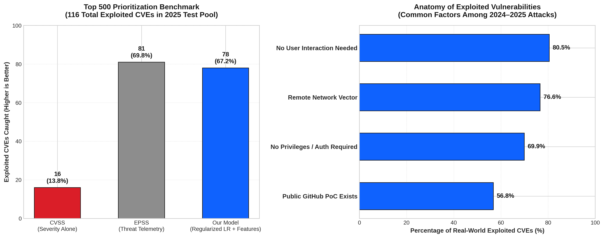
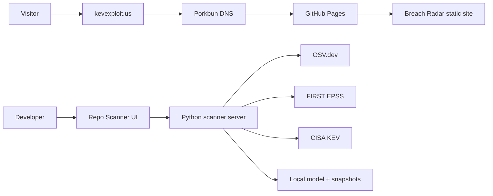

# KEVexploit — Breach Radar and Repository Scanner

> **IBM Before the Breach · Sheridan Datathon 2026**


KEVexploit is a predictive vulnerability-intelligence project built around one
question:

> **Which newly published CVEs are most likely to become CISA Known Exploited
> Vulnerabilities (KEVs) next?**

The project has two connected surfaces:

1. **Breach Radar** — the public, explainable presentation and final Top 500
   ranking.
2. **Repository Scanner** — a working prototype that applies the same
   evidence-based scoring approach to dependencies found in a real GitHub
   repository.

The project is deployed as a static GitHub Pages site at
[kevexploit.us](https://kevexploit.us/). The static site is public; the
repository scanner's Python backend remains a separate service because
GitHub Pages cannot run Python code or make server-side API calls.

---

## 1. The challenge

The IBM challenge asks teams to rank **500 CVEs** from the 2026 scoreboard.
The hidden evaluation counts how many selected CVEs are later added to the
[CISA Known Exploited Vulnerabilities catalog](https://www.cisa.gov/known-exploited-vulnerabilities-catalog).

The public scoring problem is difficult because:

- most CVEs do not become KEVs;
- public exploit evidence is incomplete and changes over time;
- EPSS is useful but not sufficient by itself;
- a model can accidentally learn post-publication or post-exploitation leakage;
- the 2026 answer labels are unavailable during development.

The team therefore recreated the competition as a historical, time-aware
benchmark using 2024 and 2025 CVEs. The model only uses information available
at the relevant publication/snapshot time, then produces a ranked list of 500
2026 CVEs.

### Project scale

| Item | Value |
|---|---:|
| 2026 CVEs scored | 72,670 |
| Final selected CVEs | 500 |
| Official baseline range | 6–8 KEV hits |
| Main historical validation | 2024–2025 temporal replicas |
| Final model voters | tree, linear, Granite LoRA |
| Final diversity cap | 3 CVEs per assigner-month |



---

## 2. Surface one: Breach Radar

### What it is

Breach Radar is the public storytelling and decision-support interface. It
explains the entire path from raw vulnerability evidence to the final Top 500:

1. **Problem** — why CVSS and a single risk score are not enough.
2. **Pipeline** — point-in-time features, models, ensemble, and filters.
3. **Weights** — which signals influence the linear voters.
4. **Results** — historical baselines and model comparisons.
5. **Before the model** — exploit telemetry, clusters, and data limitations.
6. **After the model** — what the final list emphasizes and how voters agree.
7. **The list** — searchable CVE-level explanations and model ranks.

The current GitHub Pages workflow publishes `chen/frontend` and uses
`breach_radar.html` as the site home page. The workflow is defined in
[`.github/workflows/pages.yml`](.github/workflows/pages.yml).

### Public links

- **Production site:** [https://kevexploit.us](https://kevexploit.us/)
- **GitHub Pages fallback:** [https://solarcemir.github.io/Sheridan_Datathon_DATACENTERS/](https://solarcemir.github.io/Sheridan_Datathon_DATACENTERS/)
- **Repository:** [Solarcemir/Sheridan_Datathon_DATACENTERS](https://github.com/Solarcemir/Sheridan_Datathon_DATACENTERS)
- **Story-page source:** [`luis/frontend/`](luis/frontend/)
- **Radar source:** [`chen/frontend/`](chen/frontend/)

### Why the page is static

The public presentation is intentionally static and reproducible:

- no API key is exposed in the browser;
- no IBM raw data is published;
- charts and explanations are precomputed;
- the site loads quickly from a CDN;
- every push to `main` can redeploy it through GitHub Actions.

The luis story page is a separate, data-driven presentation that can be
previewed locally:

```powershell
python -m http.server 8765 --directory luis/frontend
```

Then open `http://127.0.0.1:8765/breach-story.html`.

Its data contract and rebuild process are documented in
[`luis/frontend/README.md`](luis/frontend/README.md).

---

## 3. Surface two: Repository Scanner

### What it is

The Repository Scanner turns the competition model into a developer-facing
workflow:

1. accept a `package-lock.json` or pinned `requirements.txt`;
2. resolve dependencies against OSV.dev;
3. map OSV/GHSA findings to CVE identifiers;
4. load CVE metadata from the local NVD-style snapshot;
5. fetch current EPSS and exploit-source signals;
6. exclude vulnerabilities already present in KEV;
7. score and rank the remaining matches;
8. show the evidence, score, and model caveats.

It can also clone and scan a public GitHub repository through the local API.

### Important scope boundary

The scanner is a **working MVP**, not a claim that every dependency CVE is a
newly published 2026 CVE. Most real repositories contain older vulnerabilities.
The scanner clips live features to the model's training bounds and labels
out-of-window values so the result is not presented as a validated competition
prediction.

The complete implementation and limitations are documented in
[`luis/repo_scanner/README.md`](luis/repo_scanner/README.md).

### Local setup

From the repository root on Windows:

```powershell
python -m venv .venv
.venv\Scripts\activate
pip install -r luis/repo_scanner/requirements-scanner.txt
python -E -P luis/analysis/build_features.py
python -E -P luis/repo_scanner/train_export.py
python -E -P luis/repo_scanner/server.py
```

Open:

```text
http://127.0.0.1:8900/repo-scan.html
```

The scanner needs the private competition data locally. The data is
git-ignored and must never be committed. See [`.gitignore`](.gitignore).

### Live data sources

| Source | Purpose |
|---|---|
| OSV.dev | dependency-to-advisory matching |
| NVD-style local snapshot | CVE descriptions, CVSS, CWE, assigner |
| CISA KEV | current known-exploited state and history |
| FIRST EPSS | current exploitation probability signal |
| Exploit-DB | public exploit evidence |
| Nuclei templates | detection/template evidence |
| GitHub CVE mirror | public proof-of-concept evidence |

Metasploit is deliberately not fetched per scan in this MVP because its
module-metadata payload is too large for a fast request. The UI reports this
limitation instead of silently pretending that the signal was checked.

---

## 4. Modeling approach

The final ranking is an equal-weight rank ensemble:

- **Tree voter:** bagged XGBoost models with multiple seeds.
- **Linear voters:** Luis's and Chen's regularized logistic-regression
  models.
- **LLM voter:** Chen's Granite 4.2 8B LoRA score.
- **Post-processing:** Granite-30B-informed demotion filters and a cap of
  three CVEs per assigner-month.

The final artifacts are:

- [`luis/submissions/top500_final.csv`](luis/submissions/top500_final.csv)
- [`luis/reports/top500_final_explained.csv`](luis/reports/top500_final_explained.csv)
- [`luis/analysis/final_build.py`](luis/analysis/final_build.py)

### IBM technologies

The project uses IBM Granite for:

- text embeddings and technology clustering;
- structured analyst-feature extraction;
- Granite 4.2 8B LoRA ranking;
- explanatory nearest-KEV and analyst context;
- demotion rules for low-value or misleading ranking patterns.

The ranking is still evaluated as a conventional, leakage-controlled
prediction pipeline. Granite-generated explanations are not treated as proof
of future exploitation.

### Leakage controls

The training workflow excludes fields that can reveal information added after
publication, such as NVD status, reference counts, affected CPE counts,
current modification timestamps, and current threat-intelligence text.

Historical evaluation uses forward/blocked time splits and purging of related
KEV product groups. This makes the benchmark more honest than a random split
where near-duplicate CVEs can appear in both train and test.

---

## 5. Data and reproducibility

The IBM data is intentionally not tracked in Git. Place the unzipped files
under:

```text
IBM-20261107T174321Z-1-001/IBM/data/data/
```

Important inputs include:

- `vulnerabilities.csv`
- `scoreboard_2026.csv`
- `known_exploited.csv`
- `exploit_signals_2024.csv`
- `exploit_signals_2025.csv`
- `affected_products.csv`
- `references.csv`

Raw competition data must remain local. Public pages contain aggregates,
selected CVEs, and derived explanations only.

---

## 6. Deployment: `kevexploit.us`

### Current architecture



### DNS configuration

The domain uses Porkbun DNS and GitHub Pages. The current records are:

```text
A      @      185.199.108.153
A      @      185.199.109.153
A      @      185.199.110.153
A      @      185.199.111.153
CNAME  www    solarcemir.github.io
```

Do **not** replace the authoritative nameservers unless the hosting provider
explicitly requires it. These are DNS records, not nameserver changes.

### GitHub Pages workflow

On pushes to `main` that touch `chen/frontend/**`, the workflow:

1. checks out the repository;
2. copies `chen/frontend` into `_site`;
3. copies `breach_radar.html` to `_site/index.html`;
4. adds `.nojekyll`;
5. uploads the Pages artifact;
6. deploys it through GitHub Pages.

The custom domain is configured under:

```text
Repository → Settings → Pages → Custom domain
```

After DNS resolves, enable **Enforce HTTPS** and verify both:

- [https://kevexploit.us](https://kevexploit.us)
- [https://www.kevexploit.us](https://www.kevexploit.us)

### What is and is not hosted on Pages

| Component | GitHub Pages | Reason |
|---|---|---|
| Breach Radar presentation | Yes | static HTML/CSS/JS |
| Final ranking/explanation files | Yes, if included in frontend | static files |
| Repo Scanner UI | Can be copied as static UI | browser shell only |
| Python scanner API | No | requires Python and outbound API calls |
| OSV/EPSS/KEV live lookups | No | require a backend |

To make the scanner publicly interactive, deploy its Python server separately
on a controlled host or container and configure the frontend API URL. Do not
expose a laptop through a tunnel as a permanent production service.

---

## 7. Security and operational checklist

- Keep Porkbun credentials and 2FA private.
- Keep domain lock enabled.
- Keep auto-renew enabled if the project must remain online.
- Never commit IBM raw data, model weights, API keys, or `.env` files.
- Use read-only/public GitHub scans unless authenticated cloning is explicitly
  implemented.
- Rate-limit or protect the scanner backend before making it public.
- Do not describe the local scanner as a fully hosted production API.
- Label live EPSS and exploit-source checks with their retrieval time.
- Rebuild derived artifacts after model or source-data changes.

---

## 8. Demo checklist

### Public pitch

1. Open [kevexploit.us](https://kevexploit.us/).
2. Show the problem and why single-score ranking is insufficient.
3. Walk through the evidence pipeline and historical validation.
4. Show the model voters and final filters.
5. Open the searchable Top 500 list.

### Technical demo

1. Start the local scanner server.
2. Scan a public repository with a lockfile.
3. Show dependency-to-CVE matching.
4. Expand one finding to show EPSS, exploit signals, KEV state, and score.
5. Explain the model-bound clipping and MVP limitations.

### Submission assets

- [`deliverables/before-the-breach-pitch.mp4`](deliverables/before-the-breach-pitch.mp4)
- [`deliverables/before-the-breach-pitch-narration.wav`](deliverables/before-the-breach-pitch-narration.wav)
- [`chen/video/VOICEOVER.md`](chen/video/VOICEOVER.md)

---

## 9. Honest limitations

The model cannot identify every future KEV. Historical analysis found that
many exploited CVEs have no public exploit signal and ordinary EPSS at the
time they are published. Bigger models do not remove that information gap.

The final score is therefore best understood as **prioritized decision
support**, not a guarantee. The product's value is combining multiple
point-in-time signals, exposing uncertainty, preserving an audit trail, and
giving defenders a practical starting order.

