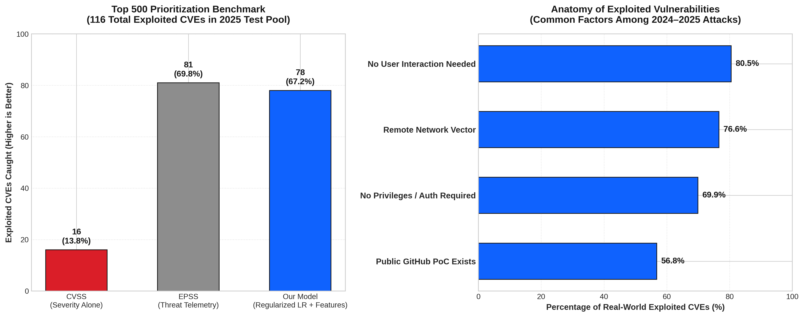
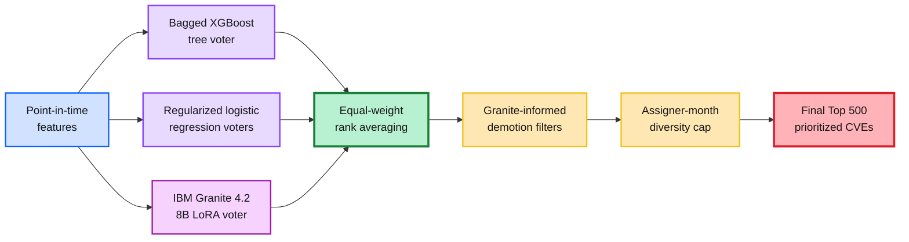

# KEVexploit

## Predicting the next breach before it becomes a headline

**IBM Before the Breach · Sheridan Datathon 2026**

[](https://kevexploit.us/)
[](https://www.ibm.com/granite)
[](#data-and-reproducibility)


KEVexploit is an **explainable vulnerability-intelligence platform** that
prioritizes the CVEs most likely to become **CISA Known Exploited
Vulnerabilities (KEVs)**. Instead of treating CVSS or EPSS as a complete
answer, it combines point-in-time exploit telemetry, vulnerability semantics,
historical KEV patterns, machine learning, and IBM Granite.

> **The problem:** defenders face thousands of new vulnerabilities, but only a
> small fraction become actively exploited. By the time a CVE appears in KEV,
> the most valuable response window may already be gone.
>
> **The solution:** rank the next likely KEVs before confirmation, explain the
> evidence behind every score, and turn the ranking into an actionable
> repository-scanning workflow.
>
> **The benefit:** security teams get a defensible, prioritized queue instead
> of an undifferentiated vulnerability backlog.

## Start here

| Resource | Link |
|---|---|
| **Live Breach Radar** | [kevexploit.us](https://kevexploit.us/) |
| **Repository** | [Solarcemir/Sheridan_Datathon_DATACENTERS](https://github.com/Solarcemir/Sheridan_Datathon_DATACENTERS) |
| **Final Top 500** | [`top500.csv`](top500.csv) |
| **Technical project guide** | [`PROJECT_OVERVIEW_AND_DEPLOYMENT.md`](PROJECT_OVERVIEW_AND_DEPLOYMENT.md) |

## Why this matters

The challenge is not simply to find vulnerabilities with a high numeric score.
It is to identify **which vulnerabilities are likely to matter next** while
avoiding information that only became available after exploitation.

KEVexploit scores **72,670 2026 CVEs** and selects a final **Top 500**. Since
the 2026 labels are hidden, we recreate the competition on historical 2024
and 2025 cohorts using forward-looking, time-aware validation.

| Scope | Result |
|---|---:|
| 2026 CVEs scored | **72,670** |
| Selected for submission | **500** |
| Official baseline range | **6–8 KEV hits** |
| Historical selection rate | **Top 441 / 64,120** |
| Final ensemble | **Tree + linear + Granite LoRA** |
| Diversity control | **Maximum 3 CVEs per assigner-month** |



## The product

### 1. Breach Radar

[Breach Radar](https://kevexploit.us/) is the public decision-support
interface. It makes the ranking auditable rather than presenting a black-box
number:

- shows the evidence pipeline from CVE to final shortlist;
- compares CVSS, EPSS, public exploit signals, and learned features;
- explains model weights, validation, filters, and uncertainty;
- exposes the final 500 CVEs with searchable reasons and model ranks;
- communicates what the models missed, not only what they found.

### 2. Repository Scanner

The [Repository Scanner](luis/repo_scanner/README.md) applies the same
prioritization philosophy to a developer's real dependencies:

1. parse `package-lock.json` or pinned `requirements.txt`;
2. resolve packages through [OSV.dev](https://osv.dev/);
3. map advisories to CVEs;
4. enrich findings with CVE metadata, EPSS, KEV state, and exploit evidence;
5. rank the findings and show why they deserve attention.

The scanner is a working MVP. Its Python API is designed to run as a separate
backend; GitHub Pages hosts the static interface but cannot execute Python or
server-side API calls.

## How the ranking works

The final submission is an equal-weight **rank ensemble**:



### Evidence used

- EPSS percentile at the relevant snapshot;
- public exploit signals from GitHub PoCs, Exploit-DB, Nuclei, and Metasploit
  metadata where available;
- CVSS 3/4 components and CWE;
- vulnerability descriptions and TF-IDF semantic features;
- historical vendor, product, and assigner behavior;
- IBM Granite-generated structured attacker-appeal and product-context
  features;
- Granite embeddings for technology clusters and nearest-KEV explanations.

### IBM technology

IBM Granite is used as a **structured reasoning and representation layer**, not
as an unsupported zero-shot oracle:

- **Granite 4.2 30B:** structured world-knowledge extraction and analyst
  features;
- **Granite 4.2 8B + LoRA:** an ensemble voter trained on historical labels;
- **Granite Embedding:** semantic clustering and nearest-past-KEV context;
- **watsonx.ai-generated notes:** display-only analyst explanations.

## Honest validation

The hidden 2026 answer cannot be used for training. We therefore use historical
replicas with publication-date splits, purged related-product groups, and
point-in-time signals.

The pipeline intentionally excludes known leakage sources such as:

- current NVD analysis status;
- post-publication reference and affected-CPE counts;
- modification timestamps;
- current threat-intelligence wording;
- CVSS exploit-maturity fields that may be filled after exploitation.

This makes the result more defensible for real-world early-warning use. It
also makes the limitation clear: many future KEVs have no public exploit code
and ordinary EPSS when first published. The system prioritizes evidence; it
does not claim certainty.

## Run locally

### Breach Radar story page

```powershell
python -m http.server 8765 --directory luis/frontend
```

Open `http://127.0.0.1:8765/breach-story.html`.

### Repository Scanner

```powershell
python -m venv .venv
.venv\Scripts\activate
pip install -r luis/repo_scanner/requirements-scanner.txt
python -E -P luis/analysis/build_features.py
python -E -P luis/repo_scanner/train_export.py
python -E -P luis/repo_scanner/server.py
```

Open `http://127.0.0.1:8900/repo-scan.html`.

Full setup, data paths, live sources, and limitations:
[`luis/repo_scanner/README.md`](luis/repo_scanner/README.md).

## Data and reproducibility

The IBM competition data is not committed to this repository. Place the
unzipped dataset at:

```text
IBM-20261107T174321Z-1-001/IBM/data/data/
```

Raw files are protected by [`.gitignore`](.gitignore). Derived artifacts,
selected CVEs, and aggregate charts are safe to publish; raw competition
records, credentials, API keys, and model weights are not.

The final ranking can be rebuilt with:

```powershell
python -E -P luis/analysis/final_build.py
```

## Deployment

The static Breach Radar site is published to GitHub Pages through
[`.github/workflows/pages.yml`](.github/workflows/pages.yml) and served at
[kevexploit.us](https://kevexploit.us/). Porkbun DNS points the apex domain
to GitHub Pages and routes `www` through the GitHub Pages CNAME.

For the complete architecture, DNS records, security checklist, and scanner
hosting boundary, see
[`PROJECT_OVERVIEW_AND_DEPLOYMENT.md`](PROJECT_OVERVIEW_AND_DEPLOYMENT.md).

## Team

This is a collaborative Sheridan Datathon project:

- **Luis** — ranking pipeline, temporal validation, explainability, frontend,
  repository scanner, and deployment.
- **Chen** — IBM Granite 4.2 extraction, LoRA modeling, GPU experiments,
  purged cross-validation, and Breach Radar presentation.
- **Honiya** — analyst drill-down dashboard and CVE dossiers.
- **Amy** — IBM watsonx.ai analyst experience and supporting project work.

See [`CONTRIBUTING.md`](CONTRIBUTING.md) for repository conventions.
